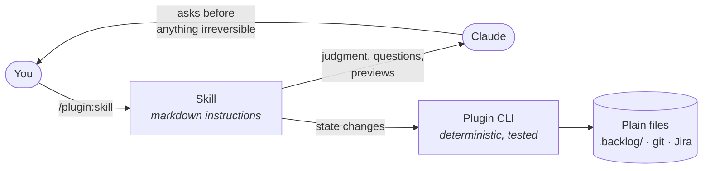

<div align="center">

# 🧠 jmlweb · Skills Monorepo

**Marketplace and source code for production-ready [Claude Code](https://claude.ai/code) plugins.**

[](https://opensource.org/licenses/MIT)
[](https://pnpm.io)
[](https://turbo.build)
[](https://www.typescriptlang.org)
[](https://nodejs.org/api/esm.html)

*All plugins — zero external services, zero databases, zero runtime dependencies.*

</div>

---

## 📦 Plugin Catalog

| Plugin | Description | Status |
|--------|-------------|:------:|
| 🌊 [**flowstate**](./plugins/flowstate/) | Backlog management — tasks, ideas, reports & learnings in plain markdown | ✅ Stable |
| 🛠️ [**dev-workflow**](./plugins/dev-workflow/) | Developer workflow — smart commits, PR review, changesets, and doc audits | ✅ Stable |
| ✨ [**atlassian-polish**](./plugins/atlassian-polish/) | Rewrite Jira issues and Confluence pages into scannable, human-friendly content | 🧪 New |

> 🔭 More plugins coming soon. Contributions welcome!

---

## 🧭 How it all fits together

Each plugin is a set of **skills** (slash commands written in markdown) that Claude follows, plus a tiny zero-dependency **CLI** for anything that must be deterministic. Skills do the thinking; the CLI does the file writes.



| Plugin | Everyday loop |
|--------|---------------|
| 🌊 **flowstate** | `idea` → `review-idea` → `start-task` → `log-progress` → `complete-task` |
| 🛠️ **dev-workflow** | `commit` → `open-pr` → `ci-triage` / `review-pr` → `pr-ready` |
| ✨ **atlassian-polish** | `atlassian-setup` → `polish-atlassian` (preview → approve → write) |

> 🛡️ **Shared principles:** nothing is written to Jira, GitHub or your backlog without a clear step you can follow; tags, pushes and merges are never implicit; every plugin works with plain files and CLIs you already have.

---

## ⚡ Quick Start

> **Prerequisites:** [Claude Code](https://claude.ai/code) installed.

```bash
# 1. Add the marketplace
claude plugin marketplace add jmlweb/skills-monorepo

# 2. Install a plugin
claude plugin install flowstate@jmlweb
```

```bash
# Install the others the same way
claude plugin install dev-workflow@jmlweb
claude plugin install atlassian-polish@jmlweb
```

Then open Claude Code in any repo and try:

| Plugin | First command |
|--------|---------------|
| 🌊 flowstate | `/flowstate:setup`, then `/flowstate:guide` for a map of every command |
| 🛠️ dev-workflow | `/dev-workflow:commit` (or just `/commit`) |
| ✨ atlassian-polish | `/atlassian-polish:atlassian-setup`, then `/atlassian-polish:polish-atlassian PROJ-123` |

Each plugin README has full usage, flags and requirements.

---

## 🧑‍💻 Development

### Prerequisites

- **Node.js** 18+
- **pnpm** 10+

### Setup

```bash
git clone https://github.com/jmlweb/skills-monorepo.git
cd skills-monorepo
pnpm install
```

### Commands

```bash
pnpm build          # Build all plugins via Turborepo
pnpm test           # Run all test suites
pnpm typecheck      # Type-check all plugins (no emit)
pnpm version:sync   # Sync plugin.json versions → marketplace.json
```

### Repository structure

```text
.claude-plugin/           # Root marketplace definition
plugins/
├── flowstate/            # Backlog management (20 skills + CLI + hooks)
├── dev-workflow/         # Commits, PRs, CI, changesets, docs (9 skills + CLI + agent)
└── atlassian-polish/     # Jira/Confluence rewriting (2 skills + agent + CLI)
packages/
└── shared-config/        # Shared TypeScript base config
docs/                     # Contributor guides (e.g. writing-skills.md)
scripts/                  # Pre-commit hook, version sync/bump, skill linter
GLOSSARY.md               # Shared vocabulary for entities and skill prose
```

Inside each plugin:

```text
.claude-plugin/plugin.json   # Manifest
skills/<name>/SKILL.md       # One folder per slash command
agents/                      # Read-only sub-agents (where used)
references/  shared/         # Deep docs and prose loaded on demand
src/  →  dist/               # TypeScript CLI source → ⚠️ pre-built output, must be committed
```

> **⚠️ Important:** `dist/` **must be committed**. Claude Code clones the repo and does not run build steps on install.

---

### Adding a new plugin

- [ ] Create `plugins/<name>/` with:
  - `.claude-plugin/plugin.json` — manifest
  - `skills/` — slash command definitions
  - `src/` + `dist/` — TypeScript CLI (if needed)
  - `package.json`
- [ ] Add an entry to `.claude-plugin/marketplace.json` with `"source": "./plugins/<name>"`
- [ ] Run `pnpm version:sync` to verify versions are in sync
- [ ] Commit the built `dist/`

---

## 🤝 Contributing

Contributions, issues, and feature requests are welcome!

1. **Fork** the repo
2. **Create** a feature branch: `git checkout -b feat/my-new-plugin`
3. **Commit** following [Conventional Commits](https://www.conventionalcommits.org/): `feat(flowstate): add archive command`
4. **Open** a Pull Request

Please make sure `pnpm build`, `pnpm test`, and `pnpm typecheck` all pass before submitting.

---

## 📄 License

[MIT](./LICENSE) © [jmlweb](https://github.com/jmlweb)

---

<div align="center">

Made with ❤️ for the [Claude Code](https://claude.ai/code) community

</div>
