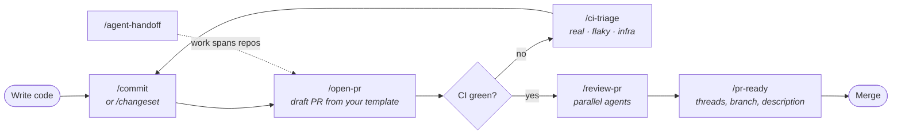

# 🛠️ dev-workflow

> A Claude Code plugin with slash commands for the day-to-day developer workflow — committing, opening and reviewing PRs, generating changesets, triaging CI — plus a hook that keeps the agent out of files you declare [read-only](#-read-only-zones).

## Installation

```bash
claude plugin marketplace add jmlweb/skills-monorepo
claude plugin install dev-workflow@jmlweb
```

The test, docs, deslop and UI skills moved to [`code-hygiene`](../code-hygiene/), which needs no GitHub.

---

## 🗺️ How the skills fit together

From first commit to merged PR, each skill hands off to the next:



> 💡 Commands are namespaced (`/dev-workflow:commit`); the short form (`/commit`) works while no other plugin claims the name. 🙋 = **you run it**: Claude never starts `/pr-ready` or `/agent-handoff` on its own; the rest it can also pick up from phrases like *"commit this"* or *"why is CI red?"*.

| Skill | Use it when… | Writes anything? |
|-------|--------------|------------------|
| ✍️ `/commit` | you have staged changes | A commit, after you approve the message |
| 📦 `/changeset` | a Changesets monorepo needs a version bump | A changeset file + commit |
| 🚀 `/open-pr` | the branch is ready for review | Push + draft PR, after you approve |
| 🚦 `/ci-triage` | CI is red and you don't know why | Nothing until you confirm a rerun/issue |
| 🔎 `/review-pr` | you want a second opinion before merge | `review.md`; PR comments only for findings you pick |
| ✅ 🙋 `/pr-ready` | your own PR needs to get over the line | Branch merge, replies, description — each confirmed |
| 🤝 🙋 `/agent-handoff` | work spans several repos | Nothing (read-only) |

---

## Skills

### ✍️ `/commit` — Smart commits

Analyzes staged changes, infers the commit type and scope, and generates a [Conventional Commits](https://www.conventionalcommits.org/) message for your approval.

```bash
/commit                           # interactive — analyzes and suggests
/commit "feat: add dark mode"     # direct message
/commit "fix(auth): token expiry" # with explicit scope
```

**What it does:**
- 🔍 Detects commit type from the diff (`feat`, `fix`, `refactor`, `perf`, `docs`, `chore`…)
- 🌿 Infers scope from directory structure or branch name
- 🔐 Scans staged files for secrets before committing (`.env`, API keys, SSH keys…)
- ⚠️ Warns before committing to `main`/`master`
- 🪝 Surfaces hook failures and never skips them without your permission

---

### 📦 `/changeset` — Monorepo changesets

For [Changesets](https://github.com/changesets/changesets)-managed monorepos. Detects which packages changed, picks the right semver bump, generates the changeset file, and commits everything.

```bash
/changeset                    # interactive
/changeset "feat: new export" # direct message
```

**What it does:**
- ✅ Validates the `.changeset/` directory exists
- 📂 Identifies modified packages from staged files
- 🏷️ Classifies the bump type (`major` / `minor` / `patch`) from the nature of the changes
- 🎲 Generates a randomized changeset filename (`calm-lions-dance.md`)
- 🚫 Never runs `changeset version` locally — leaves that to CI

---

### 🔎 `/review-pr` — PR review with parallel agents

Fetches the PR diff and launches specialized agents in parallel to produce a structured review with risk assessment.

```bash
/review-pr        # detects PR from current branch
/review-pr 123    # by PR number
/review-pr <url>  # by full GitHub URL
/review-pr --all  # also show Nice to Have and Info findings
```

**What it does:**
- 🧑‍💻 Always runs a **code-reviewer** for quality and conventions
- 🔒 Conditionally adds a **security-reviewer** (auth, payments, env vars, DB queries)
- 🧪 Conditionally adds a **qa-engineer** (critical user flows, new API endpoints)
- 📏 **Standards axis**: repo rules plus a code-smell baseline (Fowler smells, judgement calls, repo standards win)
- 🎯 **Spec axis**: a general-purpose agent checks the diff against the originating task's acceptance criteria (missing or partial, scope creep, wrongly implemented), quoting each criterion
- 🔗 Spec is found via a task/report ID (`TSK-`/`RPT-`) in branch, title, body or commits, then a local `.backlog/` task file, then the PR body or linked issue; with none, the Spec axis is skipped ("no spec available"). Works without flowstate
- ✅ Checks CI status via `gh pr checks`
- 📋 Produces a full report with risk matrix and merge recommendation
- ⚖️ The two axes are reported in separate sections, each with its own worst finding, never merged or re-ranked
- 🔢 Numbers findings (`#1`, `#2`, …) across all agents and both axes as `path:line: severity: finding`
- 🎯 Shows only **Critical, Must Fix and Should Fix** by default; `--all` adds Nice to Have and Info
- 📄 The full unfiltered report is always written to `review.md`
- 💬 Posts only the findings you pick, as one review with inline comments, after you confirm the exact text (lines outside the diff go into the review body)

> **Requires:** [GitHub CLI](https://cli.github.com/) installed and authenticated (`gh auth login`)

---

### 🚦 `/ci-triage` — Explain a red CI run

Classifies each failure of a failed GitHub Actions run as **real**, **flaky** or **infra**, with evidence, and recommends one action per failure.

```bash
/ci-triage        # latest failed run on the current branch
/ci-triage 123    # by PR number
/ci-triage <url>  # by run URL
```

**What it does:**
- 📜 Fetches only the failing jobs and steps via `gh run view --log-failed`
- 🧭 Real → points at `file:line` and the likely commit; flaky → compares with base-branch history; infra → matches runner/network/registry signatures
- 🔁 Suggests `gh run rerun --failed` or one deduped issue per flaky test
- 🙋 Read-only until you confirm any rerun or issue creation

> **Requires:** [GitHub CLI](https://cli.github.com/) installed and authenticated (`gh auth login`)

---

### 🚀 `/open-pr` — Open a PR people want to read

Turns the current branch into a pull request. The description is written from your PR template by a read-only `pr-writer` agent: why first, plain words, no file-by-file changelog.

```bash
/open-pr                          # draft PR against the default branch
/open-pr --ready                  # regular PR instead of a draft
/open-pr --base develop           # another target branch
/open-pr --template docs/pr.md    # use a specific template file
```

**What it does:**
- 🛫 Preflight: `gh` authenticated, not on the base branch, commits ahead, no PR already open (then it points you to `/pr-ready`)
- 🔐 Scans every commit in `<base>...HEAD` for secrets and sensitive files; stops on findings
- 🔎 Reviews the diff with `code-reviewer` (plus `security-reviewer` for auth, env, payments or DB changes) and recommends fixing Critical or Must Fix findings first
- 🧩 Resolves the template (see below) and suggests a Conventional Commits scope for the title
- 🗺️ Adds one Mermaid diagram of the change when it is structurally complex (several interacting parts, a new flow or a new cross-package dependency); small PRs get none
- 👀 Shows the findings, title and body and waits for you to fix first, approve, edit or cancel
- 📤 Only then runs `git push -u` and `gh pr create --draft`
- 🔒 Never force-pushes, never creates anything before you say yes

> **Requires:** [GitHub CLI](https://cli.github.com/) installed and authenticated (`gh auth login`)

---

### 🧾 PR templates

`/open-pr` and `/pr-ready` pick the first template that exists:

1. **Your repo's template** — GitHub's standard locations: `.github/pull_request_template.md`, then `docs/`, the repo root, or a `PULL_REQUEST_TEMPLATE/` folder. If several match, you are asked which one.
2. **Your personal default** — `pr-template.md` in the plugin's data directory.
3. **Built-in** — Why / What changed / How to test / Notes for reviewers.

**How a template is read:**

| In the template | What happens |
|:----------------|:-------------|
| `## Heading` | A section; kept in order |
| `<!-- ... -->` under a heading | An instruction for the writer; removed from the output |
| `<!-- optional ... -->` | The section is dropped when it does not apply |
| Section without `optional` | Always kept, `N/A` if there is nothing to say |
| `- [ ]` checklist items | Copied as written, never ticked |

**Example:**

```markdown
## Why
<!-- The problem in two sentences. Link the ticket instead of retelling it. -->

## Screenshots
<!-- optional: only for UI changes -->

## Checklist
- [ ] Tests added
- [ ] Docs updated
```

**Set a personal default:** save your template as `pr-template.md` in the plugin data directory (`~/.claude/plugins/data/dev-workflow-jmlweb/` on a standard install). Run `/open-pr` once; it reports which template source it used, so you can confirm. Repo templates always win over it.

The writing rules live in `references/pr-style-guide.md`.

---

### ✅ `/pr-ready` — Get your PR mergeable

Drives your own open PR to a mergeable state: updates the branch, triages red CI, handles unresolved review threads, trims the description, and requests reviewers.

```bash
/pr-ready          # PR of the current branch
/pr-ready 123      # by PR number
/pr-ready --merge  # also merge once CI is green
```

**What it does:**
- 🔄 Merges the base branch in; stops and asks on conflicts
- 🚦 On red CI, hands off to `/ci-triage`
- 💬 Splits unresolved review threads into *fixable* and *needs you*, fixes the first group within your branch diff
- 🙋 Posts one-line replies and resolves threads only after you confirm
- ✂️ Rewrites the PR body through your [PR template](#-pr-templates) so it reads well and stays lean
- 🔒 Never merges without `--merge`, never pushes to the base branch, never force-pushes without asking

> **Requires:** [GitHub CLI](https://cli.github.com/) installed and authenticated (`gh auth login`)

---

### 🤝 `/agent-handoff` — Multi-repo agent handoffs

Standardizes work split across repos and run by parallel agents: writes one self-contained prompt per target repo, then reconciles the reports that come back.

```bash
/agent-handoff out   # one prompt per target repo, from the current context
/agent-handoff in    # paste the original handoff + the agent report to reconcile
```

**What it does:**
- 📨 `out`: fixed sections per prompt: goal, links, constraints, decisions made, done-criteria, and a short report-back block
- 🌿 Names a branch (never a worktree or local path) and keeps secrets and machine-local paths out of prompts
- 🔍 `in`: lists what is **done**, **open** and **contradicted**, then prints follow-up handoffs if work remains
- 🧼 Stateless — both inputs are pasted, so it works after `/clear`
- 🔒 Read-only: writes no files and touches no tracker
- ⚠️ `in` compares text claims only; it cannot verify state in other repos, so it tells you how to check each claim

---

## 🔒 Read-only zones

A `PreToolUse` hook that blocks `Edit`, `Write` and `NotebookEdit` calls on files your repo declares off-limits: generated output, lockfiles, vendored code, anything the agent should read but never touch. Repos without the config file see no change.

Declare the zones in `.claude/read-only-zones.json` at the project root: a JSON array of entries, each with a `glob` and a `why`. Both are required; the `why` is what Claude reads when it is blocked, so write it for a reader who was about to make the edit.

```json
[
  { "glob": "plugins/*/dist/**", "why": "build output; edit src/ and run pnpm build" },
  { "glob": "**/*.lock", "why": "lockfiles are written by the package manager" },
  { "glob": "vendor/**", "why": "third-party code, patched upstream only" }
]
```

**Glob rules:** patterns match the whole path relative to the repository root, with `/` separators. `**` crosses directories (`dist/**`, `**/generated/*.ts`), `*` and `?` stay within one segment, `{js,ts}` lists alternatives, `[ab]` is a character class (`[!a]` negates) and a trailing `/` matches everything below that directory. `*.md` matches a root-level file only; use `**/*.md` for any depth.

**How a path is matched:** the hook walks up from the target file to the nearest `.git` entry (a directory in the main checkout, a file in a linked worktree) and matches the path relative to that root, so the same zones apply inside `git worktree` checkouts. A nested repository or submodule inside the project is not a root of its own: `vendor/lib/x.js` is matched as `vendor/lib/x.js`, so `vendor/lib/**` covers it and a root-level `dist/**` leaves `vendor/lib/dist/` alone. Paths are normalised first, so `src/../dist/x.js` is still `dist/x.js`. When the session started in a subdirectory of a larger repository, the config in that subdirectory applies and its globs are relative to the subdirectory, so `dist/**` in `packages/app/.claude/read-only-zones.json` means `packages/app/dist/`; files elsewhere in that repository are allowed. Paths compare through their real locations and, on macOS and Windows, without regard to case. A file outside the project (another repository, or no `.git` above it) is always allowed.

**What to expect:**
- 🚫 A blocked call fails with the matched path, the glob and your `why`; Claude sees that message and can tell you what it wanted to change
- 🔐 `.claude/read-only-zones.json` is itself an implicit zone, so the agent cannot widen or remove a zone; you edit it by hand
- 💥 A config that is missing a `why`, is not an array or is not valid JSON blocks **every** edit in that project until you fix the file by hand; the message names the file and the error
- 📍 The config is always read from `CLAUDE_PROJECT_DIR`, the directory where the Claude Code session started. A config that only exists on a worktree branch is not seen, and a session started in a subdirectory does not see the config at the repository root
- ⚡ Without the config file the hook exits before reading its input, so it costs nothing

> ⚠️ **Not a security boundary.** The hook only sees `Edit`, `Write` and `NotebookEdit`. A `Bash` command (`echo > dist/x.js`, `sed -i`, `git checkout`) can still write to a zone. Use it to keep an agent from drifting into files it should leave alone, not to protect secrets or enforce policy; for that, use [permission rules](https://code.claude.com/docs/en/permissions) and your repository's own protections.

---

## 🚢 Semver gate

`/open-pr`, `/pr-ready` and `/commit` judge a change's semver impact from the real diff, not from its title. They report a mismatch and stop for your confirmation before a breaking change. The release mechanism (semantic-release, Changesets, release-please, GoReleaser, tags, manual) is discovered from the repo; when it cannot be determined, the verdict says so and is only advisory. Procedure: [`shared/semver-impact.md`](shared/semver-impact.md).

---

## 🧰 CLI

The skills call a bundled zero-dependency CLI for everything that must be deterministic. You can run it directly too: add `--json true` to any command for JSON output.

```bash
node plugins/dev-workflow/dist/bin/dev-workflow.js <command> [flags]
```

| Command | Used by | What it does |
|---------|---------|--------------|
| `scan-secrets` | `/commit`, `/changeset`, `/open-pr` | Scans staged changes (or `--range <base>...HEAD`) for secrets and sensitive files |
| `detect-scope` | `/commit`, `/changeset`, `/open-pr` | Suggests a Conventional Commits scope from the files and branch |
| `detect-packages` | `/changeset` | Lists workspace packages touched by staged files |
| `changeset-name` | `/changeset` | Generates an unused `adjective-noun-verb` changeset name |
| `find-pr-template` | `/open-pr`, `/pr-ready` | Resolves the PR template: repo, then `--user-dir`, then built-in |

Exit codes: `0` clean, `1` findings or a failed verification, `2` error.

---

## Requirements

| Skill | Requirement |
|:------|:------------|
| `/commit` | Git |
| `/changeset` | Git + `.changeset/` directory |
| `/review-pr` | Git + GitHub CLI (`gh`) |
| `/ci-triage` | Git + GitHub CLI (`gh`) |
| `/open-pr` | Git + GitHub CLI (`gh`) |
| `/pr-ready` | Git + GitHub CLI (`gh`) |
| `/agent-handoff` | None (no external CLI) |
| Read-only zones hook | Node (bundled with Claude Code's requirements) + `.claude/read-only-zones.json` in the project |

## License

MIT
