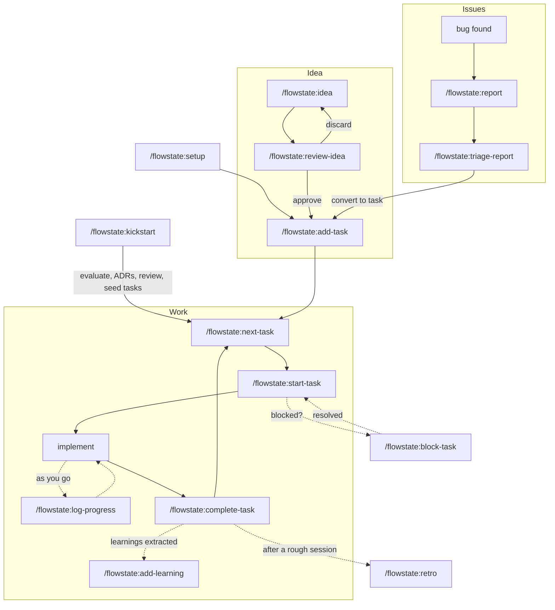
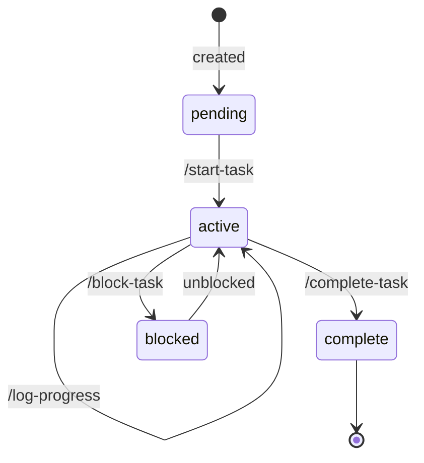
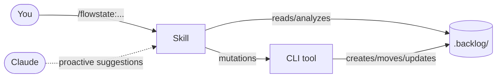
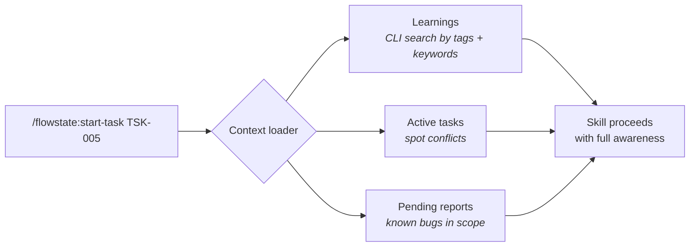
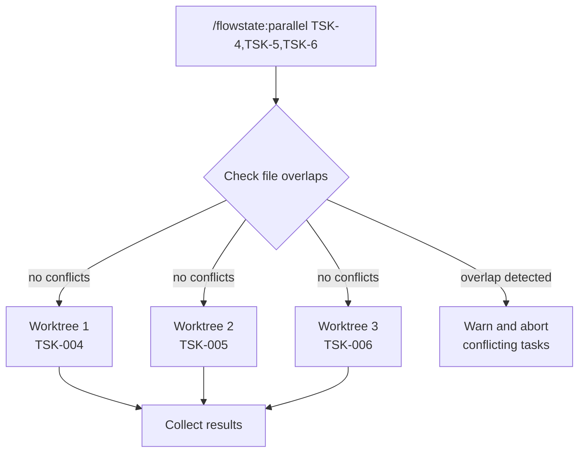

<div align="center">

# 🌊 Flowstate

**Backlog management for [Claude Code](https://code.claude.com/docs) — tasks, ideas, reports, and learnings, all in plain markdown.**

No external services. No databases. Just files and Git.

[](LICENSE)

</div>

---

## ✨ What is Flowstate?

Flowstate adds a structured, file-based backlog to any project. Everything lives in a `.backlog/` directory that you can read, edit, and commit alongside your code. Claude understands the full system and manages the lifecycle end to end: **triage → idea → implement → learn**.

```
.backlog/
├── tasks/          # pending → active → complete
├── ideas/          # pending → approved/discarded
├── reports/        # pending → triaged/discarded
└── learnings/      # searchable knowledge base
```

---

## 🚀 Quick start

### 1. Install

```bash
# From the marketplace (recommended)
claude plugin marketplace add jmlweb/skills-monorepo
claude plugin install flowstate@jmlweb
```

### 2. Initialize your backlog

```
/flowstate:setup
```

### 3. Start working

```
/flowstate:add-task                   # add your first task
/flowstate:start-task TSK-001         # start working on it
# ... do the work ...
/flowstate:complete-task TSK-001      # mark it done
/flowstate:overview                   # see the big picture
```

That's it. You're managing a backlog. 🎉

---

## 📦 Installation

<details>
<summary><strong>🏪 Marketplace (recommended)</strong></summary>

```bash
claude plugin marketplace add jmlweb/skills-monorepo
claude plugin install flowstate@jmlweb
```

</details>

<details>
<summary><strong>👥 Team setup</strong></summary>

Add the marketplace to your project's `.claude/settings.json` so everyone has access:

```json
{
  "extraKnownMarketplaces": ["jmlweb/skills-monorepo"]
}
```

Then each team member runs:

```bash
claude plugin install flowstate@jmlweb
```

</details>

<details>
<summary><strong>🔧 Manual installation</strong></summary>

No build step needed — `dist/` ships pre-built.

```bash
git clone https://github.com/jmlweb/skills-monorepo.git
# then point Claude Code at the plugin subdirectory:
claude --plugin-dir ./skills-monorepo/plugins/flowstate
```

Or as a submodule:

```bash
git submodule add https://github.com/jmlweb/skills-monorepo.git .claude/skills-monorepo
```

</details>

<details>
<summary><strong>🧪 Local development</strong></summary>

```bash
claude --plugin-dir ./skills-monorepo/plugins/flowstate
```

Use `/reload-plugins` after making changes.

</details>

---

## 📋 Commands

> 🙋 = **you run it** — Claude never fires these on its own. Everything else Claude can also reach for when you say things like *"add a task"*, *"what's next?"* or *"I'm done with TSK-004"*.

### Core

| Command | Description |
|---------|-------------|
| 🙋 `/flowstate:setup` | Create the backlog (`.backlog/` by default, or a [private location](#-private-backlog)). Safe to re-run |
| 🙋 `/flowstate:kickstart [description]` | New project? Grills the idea, then evaluates it honestly: is the need real, what already covers it, does it work for your goal, and what is the riskiest assumption. Drafts ADRs, `AGENTS.md` and an overview, has an independent agent review them, then seeds tasks that start by testing that assumption. Creates the backlog if missing and never overwrites existing files |
| 🙋 `/flowstate:guide [situation]` | Not sure what to run? Maps the commands into flows and names the next one |
| `/flowstate:overview` | Stats, active work, and health warnings at a glance |

### 📝 Tasks

| Command | Description |
|---------|-------------|
| `/flowstate:add-task` | Groom a request into a task: one round of proposals (title, criteria, priority, tags, dependencies) where *"yes"* accepts all |
| `/flowstate:next-task` | Recommends what to start — scored by priority, unblocked status and what it unblocks. Suggests a parallel-safe group of up to 3 when tasks don't overlap |
| `/flowstate:start-task` | Pending → active. Surfaces relevant learnings, active tasks and known bugs first |
| `/flowstate:log-progress` | Dated progress entries + ticks criteria **with evidence**. Handy before `/clear` |
| `/flowstate:complete-task` | Re-runs the evidence for every ticked criterion, extracts learnings, then moves the task to done |
| `/flowstate:block-task` | Block a task with a documented reason; suggests alternatives |
| `/flowstate:check-task` | Does the declared status match the code? One task or the whole backlog |
| `/flowstate:parallel` | Run independent tasks side by side in isolated git worktrees |
| 🙋 `/flowstate:condense-tasks` | Shrink completed task files (drop notes, trim the log, compress prose). Runs in an isolated subagent so the loop stays out of your context |

### 🗺️ Ideas

| Command | Description |
|---------|-------------|
| `/flowstate:idea` | Design before you code: asks the open questions in rounds, explores the codebase, writes an implementation plan |
| 🙋 `/flowstate:review-idea` | Review every pending idea in order, or one by ID: approve it (becomes a task), discard it, or revise it |

### 🐛 Reports

| Command | Description |
|---------|-------------|
| `/flowstate:report` | File a structured bug, finding, or security issue |
| 🙋 `/flowstate:triage-report` | Triage every pending report in severity order, or one by ID: turn it into a task, discard it, or ask for more info |

### 💡 Learnings

| Command | Description |
|---------|-------------|
| `/flowstate:add-learning` | Record a non-obvious insight discovered while working |
| `/flowstate:learnings` | Browse and search past insights |
| 🙋 `/flowstate:condense-learnings` | Dedupe, normalize tags, archive stale entries, compress the rest. Runs in an isolated subagent |
| 🙋 `/flowstate:retro` | Review a session, rank its mistakes, and file approved fixes as check tasks, `AGENTS.md` proposals, or learnings |

### 🌐 Shared learnings

Learnings are the one thing worth carrying across projects: tooling footguns, Claude Code quirks, testing patterns. Flowstate keeps a user-level registry of every backlog it touches (`$XDG_CONFIG_HOME/flowstate/backlogs`, falling back to `~/.config/flowstate/backlogs`). `learning-search` and `learning-list` read the active learnings of the other registered backlogs too. Shared reads are read-only; tasks, ideas and reports never leave their backlog.

On by default. Each result carries a `source`: `local`, or the name of the project it came from. Skills that add or dedupe learnings (`add-learning`, `complete-task`, `retro`, `condense-learnings`) search the local backlog only, so a learning from another project is never edited or archived by mistake. Pass `--scope local` to any search to get the same restriction.

> **Privacy:** a learning written in a client project becomes visible to every other project on this machine that flowstate has touched. Opt out in any project that handles client work.

To opt out, set `FLOWSTATE_SHARED=off` in `.claude/settings.local.json`, or in `~/.claude/settings.json` for every project:

```json
{ "env": { "FLOWSTATE_SHARED": "off" } }
```

A registered backlog that has moved or been unmounted is skipped with a warning on stderr, and its entry stays in the registry. Delete the line by hand to forget it.

---

## 🧠 Smart features

### 🔮 Context-aware skills

Skills that involve starting or planning work automatically load relevant context before acting:

- **Learnings** — retrieved via deterministic CLI search (scored by tag match + keyword relevance)
- **Active tasks** — to spot conflicts and overlaps
- **Pending reports** — known bugs in scope

If nothing relevant is found, the skill proceeds silently. The goal is **zero-effort awareness** — the backlog informs the work automatically.

> Affected skills: `start-task`, `next-task`, `idea`, `parallel`

### 🤖 Proactive behavior

Claude suggests Flowstate commands when relevant — you don't always need to invoke them manually:

| Situation | Claude suggests |
|-----------|-----------------|
| 🐛 Discovers a bug while working | `/flowstate:report` |
| 💡 Learns something non-obvious | `/flowstate:add-learning` |
| 🏗️ Starting a complex feature | `/flowstate:idea` |
| ✅ Finishes work on a task | `/flowstate:complete-task` |
| 📖 Before starting work | Reads learnings to avoid past mistakes |

### 🗣️ Questions in rounds, not one by one

`idea` and `add-task` ask everything that is open **in a single round**. Each question comes with a recommended answer, so replying *"yes"* accepts the lot; override one with `Q2: P2`. Facts the repo can answer are looked up, never asked.

### 🧾 Done means proven

Ticking an acceptance criterion records *how you know*:

```markdown
- [x] 2. Token refresh works within the expiry window
      — evidence: pnpm test auth → exit 0 (2026-04-05)
```

`complete-task` **re-runs** command-type evidence fresh and flags anything unticked, unproven, or now failing before it lets the task move to done.

### 🪝 Hooks

| When | What happens |
|------|--------------|
| A test command (`vitest`, `jest`, `pytest`, `pnpm test`…) fails | Claude is nudged to consider `/flowstate:report` |
| Before a `git commit` while tasks are active | Claude sees the active tasks and considers `/flowstate:complete-task` |

> Hooks need `jq` on your `PATH`.

### ⚡ Parallel execution

Run independent tasks simultaneously in isolated git worktrees:

```
/flowstate:parallel TSK-004,TSK-005,TSK-006
```

Each subagent works in isolation. Overlap detection prevents conflicts. Results are collected when all tasks finish.

---

## 🔄 The workflow loop



### Task lifecycle



### 🧭 Lost? Ask the guide

`/flowstate:guide` prints the map above in text form. Give it a situation (*"I found a bug"*, *"I have a vague idea"*) and it names the exact command to run next.

---

<details>
<summary><h2>🏗️ Technical details</h2></summary>

### Architecture

```
flowstate/
├── .claude-plugin/
│   └── plugin.json           # plugin manifest
├── skills/                   # 21 slash commands (SKILL.md each)
├── agents/                   # kickstart-reviewer, read-only reviewer for /flowstate:kickstart
├── shared/                   # prose shared by skills (grilling, templates)
├── hooks/
│   ├── hooks.json            # event handlers
│   ├── on-test-failure.sh    # suggests /flowstate:report
│   └── pre-commit-reminder.sh
├── src/                      # TypeScript source
│   ├── bin/flowstate.ts      # CLI entry point
│   ├── commands/             # CRUD operations
│   └── core/                 # types, frontmatter, paths, etc.
├── dist/                     # pre-built JS (ships with the plugin)
├── references/               # templates and docs
├── SKILL.md                  # plugin-level context for Claude
└── README.md
```

The plugin follows a clear separation of concerns:

- **Skills** (markdown) handle orchestration — they tell Claude *what* to do
- **CLI** (TypeScript) handles mutations — it *does* the file operations deterministically
- **Hooks** handle proactive triggers — they fire on events like test failures



### Backlog structure

```
.backlog/
├── tasks/
│   ├── pending/              # TSK-001-add-auth.md
│   ├── active/               # TSK-003-fix-pagination.md
│   ├── complete/             # TSK-002-setup-ci.md
│   └── index.md              # auto-generated stats
├── ideas/
│   ├── pending/              # PLN-001-api-redesign.md
│   └── complete/
├── reports/
│   ├── pending/              # RPT-001-memory-leak.md
│   └── complete/
└── learnings/
    ├── index.md              # searchable index
    └── LRN-001-cache-gotcha/ # individual entries
        └── index.md
```

Every file uses YAML frontmatter for metadata and markdown for content:

```markdown
---
id: TSK-001
title: Add user authentication
status: pending
priority: P2
tags: [backend, auth]
created: 2026-04-05
depends-on: []
---

# Add user authentication

## Description
Implement JWT-based auth for the API.

## Acceptance Criteria
- [ ] Login endpoint returns a valid JWT
- [ ] Protected routes reject unauthenticated requests
- [ ] Token refresh works within the expiry window
```

### ID format

| Type | Format | Example |
|------|--------|---------|
| Task | `TSK-XXX` | `TSK-001` |
| Idea | `PLN-XXX` | `PLN-003` |
| Report | `RPT-XXX` | `RPT-007` |
| Learning | `LRN-XXX` | `LRN-002` |

### Priority levels

| Level | Meaning |
|-------|---------|
| **P1** 🔴 | Critical — blocking other work |
| **P2** 🟠 | High — do next |
| **P3** 🟡 | Normal backlog |
| **P4** 🟢 | Nice to have |

### Context loading flow



### CLI reference

The skills shell out to a small CLI (`dist/bin/flowstate.js`). Run `flowstate --help` for the full command list, or `flowstate <command> --help` for per-command usage. A few flags worth knowing:

| Command | Flag | Default | Notes |
|---------|------|---------|-------|
| `learning-list` | `--status <active\|archived\|superseded\|all>` | `active` | Filter by learning status. Active-only by default — archived and superseded entries stay out of the list unless asked for |
| `learning-list` | `--include-archived true` | `false` | Alias for `--status all`. Surfaces archived and superseded entries alongside active ones |
| `learning-list` | `--all true` | `false` | Legacy alias for `--include-archived` / `--status all` (kept for backwards compatibility) |
| `learning-search` | `--tags t1,t2` | — | Comma-separated tag filter. Matches only active learnings |
| `learning-search` | `--query <text>` | — | Keyword search across title and body, scored deterministically |
| `learning-search` | `--scope <local\|all>` | `all` | `local` reads this backlog only. `all` also reads registered sibling backlogs; each result carries `backlog` (path) and `source` (last text column) |
| `learning-list` | `--scope <local\|all>` | `all` | Same meaning as for `learning-search` |
| `task-update` | `--evidence '{"2":"pnpm test → exit 0"}'` | — | JSON object keyed by criterion number; written as an inline `— evidence: … (date)` suffix. Every key must also be in `--check` |
| `task-move` | `--to complete` | — | Reports ticked criteria without evidence (`unverifiedCriteria` in `--json true`). Warning only; exit code stays 0 |

```bash
node dist/bin/flowstate.js learning-list --include-archived true   # active + archived + superseded
```

The `learning-search` command always operates on active learnings — archived entries are excluded from skill auto-loads (used by `start-task`, `next-task`, `idea`, `parallel`) so stale insights don't surface as live context.

### 🔒 Private backlog

Want the backlog out of version control without touching `.gitignore`? Create it somewhere git never tracks and point flowstate at it:

```bash
node dist/bin/flowstate.js setup --private          # <common-git-dir>/flowstate, shared by all worktrees
node dist/bin/flowstate.js setup --dir /abs/path    # or any directory you like
```

`setup` prints a snippet; merge it into the git-ignored `.claude/settings.local.json` and restart the session:

```json
{ "env": { "FLOWSTATE_BACKLOG_DIR": "/abs/path/to/backlog" } }
```

How the backlog is found, in order:

1. `FLOWSTATE_BACKLOG_DIR` — use an **absolute** path. A relative value is resolved against the project root (nearest ancestor with `.git` or `.backlog`), never `CLAUDE_PROJECT_DIR`. A configured directory that does not exist is an error, not an empty backlog.
2. The nearest `.backlog/` walking up from the current directory.

Check what flowstate sees with `node dist/bin/flowstate.js path` (add `--json true` for the source). Whether Claude Code's settings `env` reaches Bash tool calls and hooks is documented only indirectly, so verify it once in a real session with `echo $FLOWSTATE_BACKLOG_DIR`. In parallel runs a private backlog needs no "start" commit and is never stale in worktrees.

### Parallel execution flow



</details>

---

## 📄 License

MIT — see [LICENSE](LICENSE).

---

<div align="center">

Made with 🌊 by [jmlweb](https://github.com/jmlweb)

</div>
